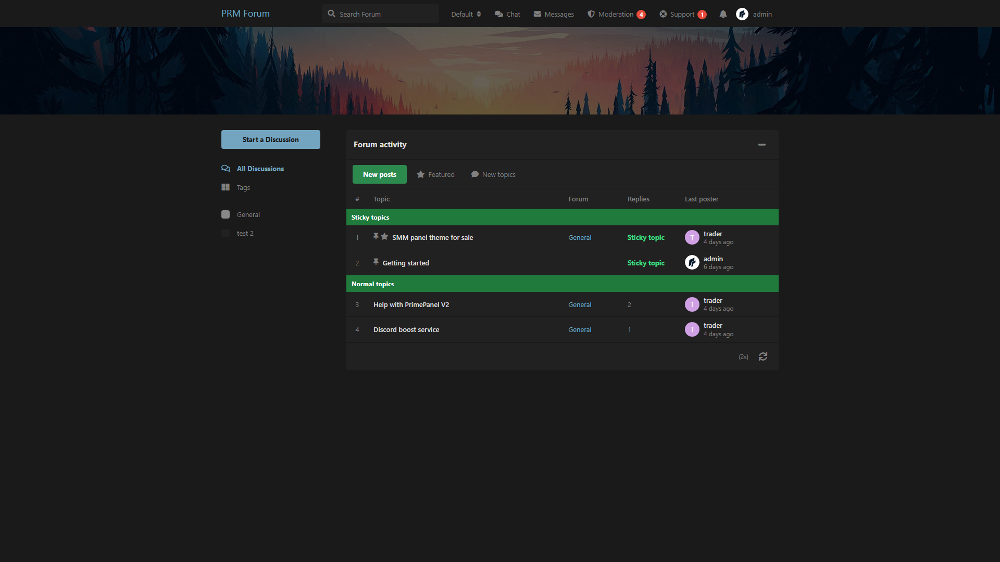

# Forum Activity

XenForo-style activity list on the homepage: sticky topics, latest posts, featured threads.

Compatible with **Flarum 2.0**.

## Screenshot



## What it does

- Replaces the default discussion list with a **forum activity** table
- Tabs: **New posts**, **Featured**, **New topics**, **Popular**, **Oldest**, **Title (A–Z)**, **Title (Z–A)**
- Sorts added by other extensions (e.g. Trending, Upvotes) show up as tabs automatically
- Each tab can be turned on / off in the admin settings
- Tabs can be shown side by side or as a single **dropdown** button (like the core sort menu)
- Respects a tag's **Default Sort** (flarum/tags) on tag pages, unless the visitor picked a tab there
- Sticky topics stay in their own section
- Staff can **feature** / unfeature a discussion from its controls
- Works with Flarum Tags (forum column uses the discussion’s tag)

## Install

```bash
composer config repositories.prm-forum-activity vcs https://github.com/smmpanelscripts1/prm-forum-activity
composer require prm/forum-activity:dev-2.x
```

Enable **Forum Activity**, then:

```bash
php flarum migrate
php flarum cache:clear
```

## How to use

1. Admin → Permissions → enable **Feature discussions** for staff
2. On a discussion, use **Feature** / **Unfeature**
3. Admin → Forum Activity: choose the default tab, the tab layout (buttons or dropdown), and which tabs are visible
4. Admin → Tags → edit a tag → **Default Sort** to open that tag with e.g. Title (A–Z)

Pairs well with **Sleek Dark XF** and **Hero Image**.

## License

MIT
